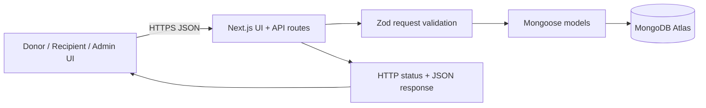

# Architecture and data model

## Collections
- **Organization**: name, type (`donor` / `recipient` / `admin`), unique email, phone, address, description, dietary needs, timestamps.
- **Listing**: donor reference/name, title/category/description, quantity/unit, preparation and expiry dates, pickup address/window, dietary tags, handling notes, status (`available`, `reserved`, `picked_up`, `expired`, `removed`), timestamps.
- **DonationRequest**: listing reference/title, recipient reference/name, requested quantity/message, status (`pending`, `accepted`, `rejected`, `cancelled`, `picked_up`), pickup confirmation time, timestamps.

## Workflow
1. Organization registers as donor or recipient.
2. Donor creates a listing; server validates required fields, date order and donor type.
3. Recipient requests an available listing; server validates recipient, quantity and duplicate active request before reserving the listing.
4. Request can be accepted/rejected/cancelled, and an accepted request can be marked picked up. Invalid transitions return 409.

## Prototype limitations
The UI's sample cards are a display fallback when the database is not configured; those cards are not database records and cannot create persistent requests. Configure `MONGODB_URI` and run the seed script for real persistent demo data. Authentication and role-based authorization are not implemented; moderation endpoints are therefore not safe for public production use. Map matching, automated reminders, multilingual support, and measured impact analytics are future scope. Food-safety information is supplied by donors and not certified by the app.
